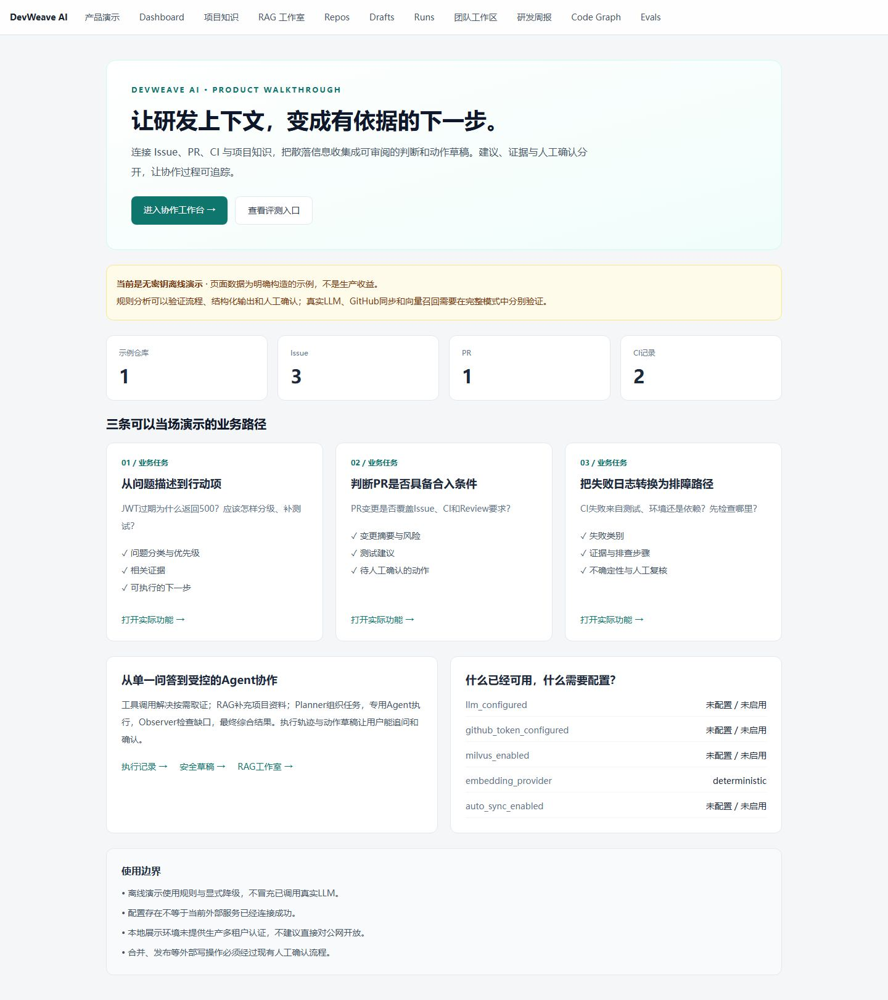
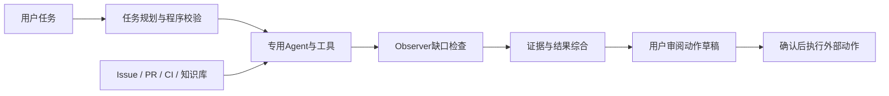

# DevWeave AI



**面向研发团队的多智能体协作工作台**：连接 Issue、PR、CI 与项目知识，将分散信息转成带证据的建议和待确认动作。

DevWeave 表示“把研发上下文编织成协作流程”。产品基于现有研发协作实现整理而来。产品名称、配置展示、提示词与文档统一使用 DevWeave AI；持久数据和旧工具协议的保留项见[更名与兼容说明](docs/branding.md)。

## 先看什么

| 入口 | 内容 |
| --- | --- |
| [产品说明](docs/product.md) | 用户问题、三条场景、验收标准和产品指标定义 |
| [面试讲解与演示](docs/interview.md) | 3分钟讲解、5分钟演示、关键技术追问 |
| [技术与完整配置](docs/development.md) | 原有架构、完整服务、RAG与评测流程 |
| [验证记录](docs/validation.md) | 本轮真实检查范围、通过项和未验证项 |
| [来源与使用边界](NOTICE.md) | 权属、第三方依赖与贡献说明 |

## 核心场景

| 场景 | 输入 | 可审阅输出 |
| --- | --- | --- |
| Issue分诊 | 描述、仓库事实、相关知识 | 分类、优先级、证据和行动建议 |
| PR就绪判断 | diff、Review、关联Issue和CI | 变更风险、测试建议、缺口与动作草稿 |
| CI排障 | 运行状态、日志和代码上下文 | 失败类别、证据与下一步检查路径 |
| 项目问答与工作流 | 自然语言需求与受限工具 | 按需取证、执行轨迹、缺口检查与人工确认 |



技术栈：Next.js、React、TypeScript、FastAPI、SQLAlchemy；完整模式支持PostgreSQL、Milvus、模型工具调用与RAG。Observer是检查环节，不保证发现所有错误。

## 无密钥本地演示

需要Python 3.12、Node.js和npm。本轮使用Node 22验证。下面从项目根目录运行；Windows激活环境后，其他命令与普通Python命令相同。

```powershell
python -m venv .venv
.\.venv\Scripts\Activate.ps1
python -m pip install -r backend/requirements.txt
npm --prefix frontend ci
python scripts/demo.py check
```

分别在两个终端启动：

```powershell
python scripts/demo.py backend
```

```powershell
python scripts/demo.py frontend
```

打开 **http://127.0.0.1:3301/showcase**。后端为 http://127.0.0.1:8801/docs 。

演示使用隔离的SQLite与明确构造的1个仓库、3条Issue、1条PR、2条CI记录，写入`.demo/`。启动器覆盖模型密钥与GitHub令牌为空，关闭自动同步和Milvus；离线规则与降级结果会显式标记。它验证产品流程，不证明真实LLM效果、GitHub同步成功或语义向量召回质量。不要点击外部写动作来展示“自动发布”。

完整模式按[技术说明](docs/development.md)配置`.env`和外部服务；配置存在与连接健康分开检查。密钥只放后端，不写入`NEXT_PUBLIC_*`。

## 测试与评测

```powershell
cd backend
python -m pytest app/tests -q
cd ../frontend
npm run build
```

后端回归、页面流程、Agent评测、RAG质量与真实业务收益分开报告。测试用例数量不是用户规模，也不等于个人独立编写的测试数量；详见[验证记录](docs/validation.md)。

## 本轮整理与贡献边界

在现有实现上新增产品演示页、运行状态摘要接口、隔离无密钥启动方式及对应检查；补齐产品场景、演示路线和验证证据。使用AI辅助整理与开发，面试时应按实际参与说明，不能将既有全部功能说成本轮从零完成。

当前适合本地展示与学习，不是已完成生产多租户认证和公网部署的服务；没有可核实的生产用户量、工时节省或商业收益数字。代码使用边界见[NOTICE](NOTICE.md)。
